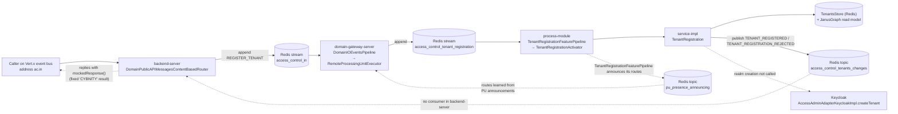

# Architecture map (draft)

> **Status: draft for Olivier Lemée to review.** This document orients maintainers in the code
> as it is on `feature-237` at `df70a3a`. It records what the source does today, and it marks
> where the code is incomplete or differs from the design docs. It doesn't propose work.
> Paths below are relative to `implementation-line/access-control/` unless they start with `/`.

The design rationale lives in the existing docs, which this map links rather than repeats:
[README](/README.md) (views and module overview),
[implementation view](/docs/implementation-view/README.md) (security controls),
[system integration](ac-system/docs/README.md) (streams, channels and dynamic routing),
[domain model](ac-domain-model/README.md) and [adapters](ac-adapter/README.md).

## Repository layout

| Path | Holds |
|:---|:---|
| `/pom.xml` | Root aggregator. Its only module is `implementation-line` (a `systems-line` module is commented out). Declares the CYBNITY artifact repositories (GitHub Packages, `nexus.agnet.fr`). |
| `/implementation-line/pom.xml` | Aggregator for `access-control`. Holds the build-stage profiles (see [Build and tests](#build-and-tests)). |
| `/implementation-line/access-control/` | The Maven modules below. |
| `/docs/` | Architecture views (the implementation view of the security controls). |
| `/.github/workflows/` | CI pipelines. |

## Modules

Group IDs are abbreviated: `ac` = `org.cybnity.application.access-control`. Dependencies are the
direct, non-test `<dependencies>` of each POM. Framework and infrastructure artifacts
(`org.cybnity.framework`, `org.cybnity.features.technical.persistence`,
`org.cybnity.infrastructure.integration.uis.adapters`) come from outside this repository.

| Module (path) | Artifact | Owns | Depends on (in repo) |
|:---|:---|:---|:---|
| `ac-domain-model` | `ac:domain` | Domain model. The IAM (`iam/domain/model`) and authorization (`authorization/domain/model`) packages hold the classes. `ciam` and `pam` hold only `package-info.java`. | none |
| `ac-translator/ac-ui-translator` | `ac.translator:ui` | UIS channel names (`UICapabilityChannel`) and UI event translation. | none (uses `redis-impl`) |
| `ac-translator/keycloak-translator` | `ac.translator:keycloak` | Mappers from Keycloak representations to Access Control objects. | `adapters:api`, `adapters:keycloak-domain-ontology-impl` |
| `ac-adapter/ac-adapter-api` | `ac.adapters:api` | SSO adapter contract and DTOs. | `ac:domain` |
| `ac-adapter/ac-adapter-admin-api` | `ac.adapters:admin-api` | Admin contracts: `IAccessAdminAdapter` (`createTenant`, `deleteTenant`, `findTenantByLabel`) and `ISSOAdminAdapter`. | `adapters:api` |
| `ac-adapter/keycloak-domain-ontology-impl` | `ac.adapters:keycloak-domain-ontology-impl` | Keycloak domain objects (`org.cybnity.keycloak.*`). | `ac:domain` |
| `ac-adapter/ac-adapter-keycloak-impl` | `ac.adapters:keycloak-impl` | `SSOAdapterKeycloakImpl` (authz client). | `adapters:api`, `translator:keycloak` |
| `ac-adapter/ac-adapter-keycloak-admin-impl` | `ac.adapters:keycloak-admin-impl` | `AccessAdminAdapterKeycloakImpl` (realm creation via the admin client) and `SSOAdminAdapterKeycloakImpl`. | `adapters:admin-api`, `adapters:keycloak-impl` |
| `ac-ui/ac-ui-api` | `ac.ui:api` | Public API vocabulary: `CommandName` (for example `REGISTER_TENANT`) and the domain event types. | none |
| `ac-service/ac-service-api` | `ac:service-api` | Application service contracts. | `adapters:api`, `translator:ui` |
| `ac-service/ac-service-impl` | `ac:service-impl` | `TenantRegistration` service, tenant write model (`TenantsStore`, a Redis event store) and read model (`TenantTransactionCollectionsRepository`, JanusGraph projections). | `service-api`, `adapters:api`, `adapters:admin-api`, `ui:api` |
| `ac-system/ac-domain-gateway-server` | `ac.system:domain-gateway-server` | **Runnable.** Domain I/O gateway. | `translator:ui` |
| `ac-system/ac-rts-computation-unit` | `ac.system:process-module` | **Runnable.** Processing unit hosting the tenant-registration pipeline. | `service-impl`, `adapters:keycloak-admin-impl` |
| `ac-ui/ac-ui-system/ac-backend-server` | `ac.ui.system:backend-server` | **Runnable.** UI-facing backend (Vert.x HTTP and event bus). | `ui:api`, `translator:ui` |
| `ac-ui/ac-ui-system/ac-frontend-server` | `ac.ui.system:frontend-server` | Declared module only: it contains a `pom.xml`, `src/LICENSE` and `src/NOTICE`, and no source. | none |

**Runnable vs library:** the three runnable systems each declare a `main.verticle` property and
the `docker-maven-plugin` in their POM, and they ship `src/main/resources/static/health.html`.
Their entry verticles are:

- `AccessControlDomainIOGateway`
- `AccessControlDomainProcessModule`
- `AccessControlReactiveMessagingGateway`

Every other module is a jar library. The root README also lists `frontend-server` as a
deployable module, but it has no code yet.

## Tenant registration: request and response path

This is the one use case wired across all layers. The arrows show what the code does;
dashed arrows mark segments that are missing or mocked.

Step by step, with the class that does each step:

1. **Entry.** `DomainPublicAPIMessagesContentBasedRouter` consumes the Vert.x event-bus address
   `CollaborationChannel.ac_in` (`"ac.in"`). The backend's HTTP router
   (`UICapabilitiesHTTPRouterImpl`) serves `/static/*` and sets CORS and forwarding headers, but
   no SockJS event-bus bridge is mounted in the non-deprecated code. Today, only in-process
   callers reach `ac.in`, such as `PublicTenantRegistrationUseCaseIntegrationTest`, which calls
   `eb.request(...)`. Bridge code exists only as `backend/deprecated/EventBusBridgeHandler`,
   which nothing references.
2. **Backend → UIS.** The router looks up the command type in `GatewayRoutingPlan`
   (`REGISTER_TENANT` → `UICapabilityChannel.access_control_in`) and appends the command to that
   Redis stream through the UIS client.
3. **Backend reply (mocked).** It replies to the caller at once with `mockedResponse(...)`, a
   success event for the organization `"CYBNITY"`. It doesn't wait for the domain's result
   (`DomainPublicAPIMessagesContentBasedRouter.java:203-209`). `startUISConsumers()` and
   `stopUISConsumers()` are empty.
4. **Gateway.** `DomainIOEventsPipeline` reads `access_control_in`, filters the supported types
   with `APISupportedCapabilitySelectionFilter`, and hands each command to
   `EventProcessingDispatcher`, which delegates it to `RemoteProcessingUnitExecutor`. That executor appends to the stream named by its routing
   plan. The plan isn't static: it's built from processing-unit announcements on
   `access_control_pu_presence_announcing`, with change requests on
   `access_control_io_gateway_dynamic_routing_plan_evolution`.
5. **Processing unit.** `TenantRegistrationFeaturePipeline` reads
   `access_control_tenant_registration` and announces its routes. `TenantRegistrationActivator`
   builds the `TenantRegistration` service with `TenantsStore` (Redis, with
   `SnapshotRepositoryRedisImpl`), `TenantTransactionCollectionsRepository` (JanusGraph) and an
   `SSOAdminAdapterKeycloakImpl`.
6. **Service.** `TenantRegistration.handle(...)` checks the tenant name and queries the read
   model by label.
   - If an *active* tenant already has that name, it emits `TENANT_REGISTRATION_REJECTED`.
   - If an inactive tenant has that name, it returns it as `TENANT_REGISTERED`.
   - Otherwise it builds a new `Tenant`, adds it to the write model, and emits
     `TENANT_REGISTERED`.

   The result goes out on the `access_control_tenants_changes` topic.
7. **Keycloak.** The service doesn't create a realm. The realm steps are TODOs
   (`TenantRegistration.java:214`, `:221`). The service holds an `ISSOAdminAdapter`, which
   declares no realm methods of its own. Realm creation is implemented in
   `AccessAdminAdapterKeycloakImpl.createTenant(...)`, which nothing in the repository calls.

## External integrations

| System | Used for | Where |
|:---|:---|:---|
| Redis | UIS streams and topics (messaging); tenant event store and snapshots | `org.cybnity.infrastructure.integration.uis.adapters:redis-impl` (external), `redis-store` (external), `TenantsStore` in `ac-service-impl` |
| JanusGraph | Tenant read-model projections | `janusgraph-repository` (external), `TenantTransactionCollectionsRepository` and `projections/` in `ac-service-impl` |
| Keycloak | SSO (authz client) and realm administration (admin client) | `ac-adapter-keycloak-impl`, `ac-adapter-keycloak-admin-impl`, `keycloak-domain-ontology-impl`, `keycloak-translator` |
| Vert.x | Runtime of the three systems (verticles, event bus, HTTP); the backend POM also pulls `vertx-auth-oauth2` and `vertx-auth-jwt` | system module POMs |

The backend POM declares the OAuth2 and JWT dependencies, but no non-deprecated backend class
imports them.

## Build and tests

- **Build:** run `mvn` from the root `pom.xml`. Dependencies resolve from the CYBNITY
  repositories declared there, so building needs access to them. CI uses JDK 11 (Temurin).
- **Stages:** `/implementation-line/pom.xml` selects a profile with `-Dstage=<name>`. The
  profiles are `commit`, `technical-quality`, `integration-quality` and `user-acceptance-test`.
  - `commit` excludes `**/*Integration*.java` and `**/*Manual*.java` from the tests.
  - `integration-quality` runs only `**/*Integration*.java`.
- **CI:**
  - `java-project-ci.yml` (commit stage) runs `mvn ... -Dstage=commit clean compile`, then
    `test`, `package` and `verify`.
  - `check-project-technical-quality.yml` and `check-project-integration-quality.yml` run the
    other stages.
  - `publish-java-packages-version-to-repository.yml` publishes the artifacts.
- **Tests:** they sit in each module's `src/test/java`. System and service tests extend a
  per-module `CustomContextualizedTest`, which builds on the framework's
  `InfrastructureContextualizedTest`. Its constructor flags choose whether a test starts with
  Redis, JanusGraph and Keycloak. `ac-adapter-keycloak-admin-impl`, `ac-adapter-keycloak-impl`,
  `ac-adapter-api`, `keycloak-translator` and `ac-service-api` have no tests.

## Current gaps and map limits

**Observed in code.** These are facts about the current source, not plans.

- In the backend, the reply is mocked and there are no UIS result consumers (step 3), and the
  event bus isn't bridged over HTTP (step 1).
- Realm creation isn't connected to tenant registration (step 7). The `enable()`, `disable()`
  and `resume()` methods of both SSO adapters are empty.
- `TenantRegistrationActivator.moveToInvalidMessageChannel` and `moveToDeadLetterChannel` only
  log (`:95`, `:108`).
- The four use-case tests in `ac-rts-computation-unit/.../TenantRegistrationUseCaseTest` flag
  their checkpoints without assertions. That class runs in the commit stage, because its name
  doesn't contain "Integration".
- `ac-frontend-server` and the domain-model `ciam` and `pam` packages are placeholders.

**Docs vs code.**

- [System integration](ac-system/docs/README.md) lists the supported command as
  `CommandName.REGISTER_ORGANIZATION`. The code uses `CommandName.REGISTER_TENANT`, and
  `REGISTER_ORGANIZATION` doesn't exist in the source.
- The root README dependency diagram omits `keycloak-domain-ontology-impl`.
- [Domain model README](ac-domain-model/README.md) links `../ac-translator/README.md`, which
  doesn't exist. The translator README is under `ac-translator/keycloak-translator/`.
- The [implementation view](/docs/implementation-view/README.md) describes six security
  controls (AC-2(8) to IA-2(10)). Their requirements live in Notion. This map didn't assess how
  much of each one is implemented beyond the tenant-registration path above.

**Limits of this map.** It was built by reading POMs and source. No Maven build or tests were
run. Framework classes outside this repository (`InfrastructureContextualizedTest`, the UIS and
persistence adapters) were not inspected.
