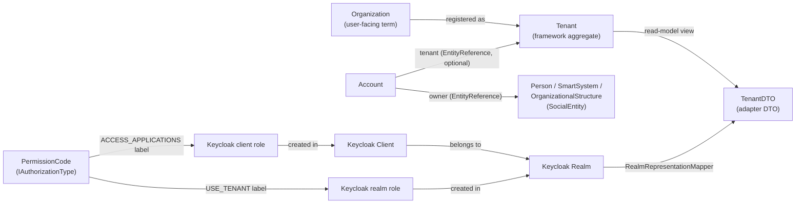

# Access Control domain vocabulary

A cross-reference of the terms used in the Access Control code, and how they relate. Each entry
gives the preferred term, a short definition, where the term lives in source, and its boundaries
or synonyms. Paths are shortened as follows:

- `ac-…` = `implementation-line/access-control/ac-…`
- `model/` = `ac-domain-model/src/main/java/org/cybnity/accesscontrol/`
- `kc/` = `ac-adapter/keycloak-domain-ontology-impl/src/main/java/org/cybnity/keycloak/domain/model/`

## Source of truth and limits

- **What this is:** a vocabulary cross-reference maintained in the repository, checked against
  the code on `feature-237` at `df70a3a`. It is not a requirements document. Requirements live in
  the specifications linked from [the implementation view](implementation-view/README.md).
- **Three kinds of statement are kept apart:**
  - **Source:** behaviour or structure present in this repository's Java code.
  - **Framework:** a type from `org.cybnity.framework`, which lives outside this repository
    (`cybnity/foundation`). Its signatures were read from the `domain` jar (`feature-237-SNAPSHOT`).
  - **Doc intent:** something stated in a README or design note that the code doesn't (yet) show.
- **Framework conventions:** see the CYBNITY framework
  [domain design view](https://github.com/cybnity/foundation/blob/main/implementations-line/framework/domain/designview-structure-models.md)
  and the [coding and naming conventions](https://github.com/cybnity/foundation/blob/main/docs/uml/implementation/how-to/coding-conventions.md).
- **Names are kept as written.** Inconsistencies are listed in
  [Naming inconsistencies](#naming-inconsistencies), not silently corrected.

## Overview

Arrows show references or mappings that exist in code. There is no code link between `Tenant`
and `Realm`: see [Keycloak Realm](#keycloak-realm).

## Organization and tenancy

### Organization

- **Definition:** the user-facing name for the customer entity that registers to use CYBNITY.
  In Access Control flows, an organization is represented by a [Tenant](#tenant).
- **Source:** the word appears in UI resource names (`ac-ui/ac-ui-api/.../experience/DocumentResourceArchetype.ORGANIZATION`,
  `CollectionResourceArchetype.ORGANIZATIONS`) and throughout the `TenantRegistration` comments.
  Every command, attribute and event identifier uses *tenant* (`REGISTER_TENANT`, `TENANT_NAMING`,
  `TENANT_REGISTERED`).
- **Boundary:** do not confuse it with [OrganizationalStructure](#organizationalstructure), which
  is an identity (a social entity) and not a tenant.
- **Doc intent:** `ac-ui/ac-ui-api/docs/README.md` describes an "Organization Registration" state
  machine with events such as `ORGANIZATION_REGISTRATION_SUBMITTED`. Those names don't exist in code.

### Tenant

- **Definition:** an organization's subscription, defining a multi-tenant scope that users and
  systems register into. It has a label and an activity status (active or not).
- **Framework:** `org.cybnity.framework.domain.model.Tenant extends Aggregate`, with the fields
  `TenantDescriptor label` and `ActivityState activityStatus`, built by `TenantBuilder`. The
  Access Control domain reuses it rather than defining its own (see `ac-domain-model/README.md`,
  "CYBNITY framework").
- **Source:**
  - The write-model contract is `model/domain/model/ITenantsWriteModel`, implemented by
    `TenantsWriteModelImpl` with `TenantsStore` (Redis) in `ac-service-impl`.
  - `TenantRegistration` creates a `Tenant` through `TenantBuilder`.
- **Boundary:** a Tenant is a domain aggregate. It is not a [TenantDTO](#tenantdto), which is a
  view of it, and not a [Keycloak Realm](#keycloak-realm).

### TenantDTO

- **Definition:** a denormalized, read-only view of a tenant version, shareable outside the domain.
- **Source:** `ac-adapter/ac-adapter-api/.../adapter/api/model/TenantDTO`. Its
  `PropertyAttributeKey` values are `IDENTIFIED_BY`, `LABEL`, `ACTIVITY_STATUS`, `DATAVIEW_TYPE`,
  `CREATED`, `COMMIT_VERSION` and `LAST_UPDATED_AT`.
- **Two origins:**
  - The domain read model (JanusGraph projections in `ac-service-impl`) returns it from queries
    such as `ACApplicationQueryName.TENANT_VIEW_FIND_BY_LABEL`.
  - `RealmRepresentationMapper` (`ac-translator/keycloak-translator`) builds one from a Keycloak
    realm.
- **Boundary:** a TenantDTO built from a realm carries Keycloak values. `IDENTIFIED_BY` is the
  realm's internal ID, `LABEL` is the realm name and `ACTIVITY_STATUS` is the realm's `enabled`
  flag. These are not the domain Tenant's identifiers.

### Keycloak Realm

- **Definition:** Keycloak's isolation unit for users, clients and roles. CYBNITY intends one
  realm per tenant, holding that tenant's SSO configuration.
- **Source:**
  - `kc/Realm extends RealmRepresentation`, with `RealmBuilder`.
  - `kc/RealmWithDefaultExtendedResources` is a realm that also carries default clients, client
    scopes and roles.
  - It is created by `AccessAdminAdapterKeycloakImpl.createTenant(...)` and mapped to a
    [TenantDTO](#tenantdto) by `RealmRepresentationMapper`.
- **Boundary:** a Realm is not the domain Tenant. The code doesn't link the two: `TenantRegistration`
  stores the Tenant but doesn't create a realm (TODOs at `TenantRegistration.java:214`, `:221`).
  The "one realm per tenant" relationship is doc intent
  ([dynamic account management](implementation-view/dynamic-account-management.md)).
- **Synonym caution:** the adapter method that creates a realm is called `createTenant`.

## Identities and accounts

### SocialEntity

- **Definition:** an identity that can interact with systems.
- **Framework:** `org.cybnity.framework.domain.model.SocialEntity`, an abstract class that
  extends `Aggregate`.
- **Source:** the three subtypes below. None of them has a tenant field.
- **Boundary:** an identity, not an [Account](#account). Accounts point to an identity as their owner.

### Person

- **Definition:** a physical social entity, such as a human.
- **Source:** `model/iam/domain/model/Person extends SocialEntity`.
- **Boundary:** not an [Account](#account). It holds no credentials and no tenant reference.

### SmartSystem

- **Definition:** a software and/or hardware system, such as an autonomous accessory acting for
  a person or organization.
- **Source:** `model/iam/domain/model/SmartSystem extends SocialEntity`.
- **Boundary:** a modelled identity with no tenant field. It is not a Keycloak `Client`, which is an
  application registration (see [Keycloak terms](#keycloak-terms)).

### OrganizationalStructure

- **Definition:** an organizational structure, such as a company, association or institution,
  that interacts with systems.
- **Source:** `model/iam/domain/model/OrganizationalStructure extends SocialEntity`.
- **Boundary:** this is an identity that can own accounts, not a [Tenant](#tenant).

### Account

- **Definition:** an allowed set of credentials belonging to an owner, within a tenant scope. It
  is the root aggregate for a subject's usable account.
- **Source:** `model/iam/domain/model/Account extends Aggregate`, with the fields
  `EntityReference owner` and `EntityReference tenant`. The constructor parameter
  `tenantIdentity` is documented as optional.
- **Tenant scope:** [Account](#account) is the only identity-side type that carries a tenant
  reference. Person, SmartSystem and OrganizationalStructure are tenant-agnostic in code.

### Owner / subject

- **Definition:** the identity an [Account](#account) belongs to. "Owner" is the field name;
  "subject" is the term used in the authorization types and in Javadoc.
- **Source:** `Account.owner()` returns an `EntityReference`. Its type isn't constrained to a
  `SocialEntity` in code. `model/iam/domain/model/SubjectAttribute` describes a subject asking
  for access (role, group, user ID, email).
- **Doc intent:** `domain-model-components.md` lists subject kinds (human, service and AI agent
  users; infrastructure, security tool and application systems) that have no dedicated classes.

### Identity attribute

- **Definition:** a criterion describing an identity, such as an email address.
- **Source:** `model/iam/domain/model/IdentityAttribute` and `IMailAddress extends IdentityAttribute`.
  The read and write contracts are `IdentitiesReadModel` and `IdentitiesWriteModel`.
- **Boundary:** it describes an identity. `SubjectAttribute` (same `iam` package) describes a
  subject *requesting access* (see [Owner / subject](#owner--subject)).

## Authorization

### Permission / authorization

- **Definition:** an OIDC authorization, commonly called a permission.
- **Source:** `model/authorization/domain/model/IAuthorization`. Its type is
  [IAuthorizationType](#authorization-type--privilege).
- **Synonyms:** *authorization* is the type name, while *permission* is used in Javadoc and docs.

### Authorization type / privilege

- **Definition:** a type of authorized action, defined by an action and a resource, for example
  `read:patients`.
- **Source:** `model/authorization/domain/model/IAuthorizationType`. It is implemented by
  [PermissionCode](#permissioncode) and extended by `Implicit` and `IClientCredentials`, which
  describe OAuth grant styles.
- **Caution:** the Javadoc also calls it a "model of authorization (e.g; requested, verified,
  accepted, rejected)". See [Naming inconsistencies](#naming-inconsistencies).

### PermissionCode

- **Definition:** the common, convention-named authorization types assigned by default.
- **Source:** `model/authorization/domain/model/PermissionCode`, an enum that implements
  `IAuthorizationType`. Its values are `USE_TENANT` (label `use-tenant`) and
  `ACCESS_APPLICATIONS` (label `access-applications`).
- **Keycloak link:** `RealmDefaultComplementaryResourcesProvider` (`ac-adapter-keycloak-admin-impl`)
  uses these labels as default role names:
  - `use-tenant` becomes a realm role (`tenantDefaultRealmRoles()`).
  - `access-applications` becomes a client role (`defaultRolesRequiredByClientId(...)`).

### Role

- **Definition:** a named set of permissions that is organization-wide or limited to a scope.
- **Source:** there is no `Role` class in `ac-domain-model`. The term appears in four places:
  - `ac-adapter/ac-adapter-api/.../model/RoleDTO`, a read-model view of an RBAC role.
  - `model/iam/domain/model/RoleBasedAccessControl`, a policy type.
  - `IAccreditation` ("ability and role allowed to a JWT token owner").
  - The Keycloak classes `kc/Role`, `kc/RealmRole` and `kc/ClientRole`; see
    [Keycloak terms](#keycloak-terms).
- **Doc intent:** `domain-model-components.md` ("Designed key roles") presents `Role` as a
  domain-model class, and it proposes role naming templates such as `manage-tenant` and
  `security-CISO`. In code, `Role` exists only in `org.cybnity.keycloak.domain.model`, and only
  `use-tenant` and `access-applications` are defined.

### Accreditation

- **Definition:** an ability and role granted to a JWT token's owner.
- **Source:** `model/authorization/domain/model/IAccreditation`, used by `IDToken`
  (`userHabilitations`).
- **Synonym:** *habilitation*, the field name in `IDToken`.
- **Boundary:** an accreditation is something *granted*. A [Claim](#claim) is information
  *about* the user. `IDToken` keeps them in separate collections.

### Claim

- **Definition:** a key-value piece of information about a user, such as a department or
  permission.
- **Source:** `model/authorization/domain/model/IClaim`, used by `IDToken` (`userClaims`).
- **Boundary:** information carried in a token, not a grant. See [Accreditation](#accreditation).

### Scope

- **Definition:** the policies and permissions a user may exercise on a resource.
- **Source:** `model/authorization/domain/model/IScope` and `model/iam/domain/model/IScopeAttribute`.
- **Boundary:** this is not a Keycloak [ClientScope](#keycloak-terms).

### Authorization policy

- **Definition:** an access-control mechanism protecting a resource, typed by strategy.
- **Source:** `model/iam/domain/model/AuthorizationPolicy` and its subclasses
  `RoleBasedAccessControl`, `AttributesBasedAccessControl`, `GroupBasedAccessControl`,
  `UserBasedAccessControl`, `ClientScopeBasedAccessControl`, `TimeBasedAccessControl` and
  `RegexBasedAccessControl`. The contracts are `IPolicy` and `IPolicyProvider` in the
  authorization package.
- **Usage:** these types are declared in the model, but no class outside `ac-domain-model`
  references `AuthorizationPolicy`.

### Controlled resource

- **Definition:** an identifiable protected object, such as a file, service or data item, and
  the policies that guard it.
- **Source:** `IResource`; `ControlledResource implements IResource`, holding
  `Collection<AuthorizationPolicy> policies`; and `IResourceServer`, the host of protected
  resources.
- **Boundary:** a domain-model type. No Keycloak class in `kc/` models protected resources, and it
  is not a Keycloak `Client`.

## Tokens and flows

| Term | Source (`model/authorization/domain/model/`) | Definition |
|:---|:---|:---|
| Security token | `ISecurityToken` | An OAuth2 token. |
| Access token | `IAccessToken extends ISecurityToken` | An access token allowed to an account. |
| Refresh token | `IRefreshToken extends ISecurityToken` | A token used to refresh an access token. |
| ID token | `IDToken implements ISecurityToken` (an abstract class) | An OIDC token with claims, accreditations, and creation, authentication and expiry times. |
| JWT token | `JWTToken`, which holds an `IDToken` | The JWT exchange format of a token. |
| Accredited user token | `AccreditedUserToken` | An accredited JWT allowed to an authenticated subject (no fields yet). |
| Authorization flow | `IAuthorizationFlow`, `IAuthorizationCodeFlow` | OIDC flow types. The implicit flow is described as not retained in [information flow enforcement](implementation-view/information-flow-enforcement.md). |

No class outside `ac-domain-model` references `IAccessToken`.

## Keycloak terms

These types live in `kc/` (`org.cybnity.keycloak.domain.model`). They extend Keycloak
`*Representation` classes and stay on the adapter side. Translators map them to Access Control
DTOs.

| Keycloak term | Class | Closest Access Control term | Boundary |
|:---|:---|:---|:---|
| Realm | `Realm`, `RealmWithDefaultExtendedResources` | [Tenant](#tenant) through [TenantDTO](#tenantdto) | The SSO container for a tenant, not the tenant itself. |
| Realm role | `RealmRole` | [PermissionCode](#permissioncode) `USE_TENANT` | Applies to all clients in the realm. |
| Client role | `ClientRole` | `PermissionCode.ACCESS_APPLICATIONS` | Scoped to one client. |
| Role | `Role` | [Role](#role), `RoleDTO` | A generic Keycloak role, which the Javadoc links to `IAuthorizationType`. |
| Client | `Client` | none | A Keycloak application registration. |
| Client scope | `ClientScope` | none (`ClientScopeBasedAccessControl` is a policy type) | A shared set of protocol mappers and roles, not a domain [Scope](#scope). |
| Protocol mapper | `ProtocolMapper` | none | Shapes the token claims Keycloak issues. |

## Commands and events (where they carry vocabulary)

- **Command:** `CommandName` (`ac-ui/ac-ui-api/.../event/`) has the values `REGISTER_TENANT`,
  `UPGRADE_TENANT`, `REGISTER_ACCOUNT` and `ACTIVATE_REGISTERED_ACCOUNT`.
  `TenantRegistrationAttributeName.TENANT_NAMING` carries the requested organization name.
- **Events:** three different enums are named `DomainEventType`.
  - `org.cybnity.application.accesscontrol.translator.ui.api.event.DomainEventType`
    (`ac-ui-translator`): `TENANT_REGISTRATION_SUBMITTED`, `TENANT_REGISTERED`, `TENANT_CHANGED`,
    `TENANT_REMOVED`, `TENANT_REGISTRATION_REJECTED`. Of these, `TenantRegistration` emits only
    `TENANT_REGISTERED` and `TENANT_REGISTRATION_REJECTED`. The other three are declared but not
    emitted by that service.
  - `org.cybnity.framework.domain.event.DomainEventType` (framework): `TENANT_CREATED` and others.
    These are the write-model events consumed by the tenant read-model projections
    (`ChangedTenantDataViewVersion`).
  - `org.cybnity.accesscontrol.iam.domain.event.DomainEventType` (`ac-domain-model`):
    `_CREATED`, `_CHANGED` and `_DELETED` events for `ACCOUNT`, `SMART_SYSTEM`,
    `ORGANIZATIONAL_STRUCTURE` and `PERSON`.

## Naming inconsistencies

These are recorded as found and not corrected:

| Where | Observation |
|:---|:---|
| `IDToken` | An abstract class whose name has the `I` interface prefix. |
| `IAuthorizationType` | Its Javadoc gives two meanings: a lifecycle status (requested, accepted, …) and a privilege (action:resource). |
| `Implicit`, `IClientCredentials` | Grant or flow styles modelled as subtypes of `IAuthorizationType`, while the flows themselves are `IAuthorizationFlow`. |
| `Account` Javadoc | Constructor parameters describe "this tenant root aggregate" and "identifier of this tenant", although the class is an account. |
| `IAccessAdminAdapter.createTenant` vs Realm | The admin adapter method `createTenant` (`ac-adapter-admin-api`) creates a Keycloak realm in `AccessAdminAdapterKeycloakImpl` and returns a `TenantDTO`. |
| `DomainEventType` | Three enums share the name (see [Commands and events](#commands-and-events-where-they-carry-vocabulary)). |
| Organization vs tenant | Docs speak of organization registration (`REGISTER_ORGANIZATION` in `ac-system/docs/README.md`, `ORGANIZATION_REGISTRATION_*` in `ac-ui-api/docs/README.md`). The code uses `REGISTER_TENANT` and `TENANT_*`. |
| `ac-domain-model/README.md` class diagram | Shows `Account` inheriting directly from `ChildFact`. In code, `Account extends Aggregate`, which extends the framework's `CommonChildFactImpl`. |
| `Role` | Documented as a domain-model class, but it exists only in the Keycloak ontology package (see [Role](#role)). |
| `ciam`, `pam` packages | Documented sub-packages (`…ciam.domain.model`, `…pam.domain.model`) that contain only `package-info.java`. |
